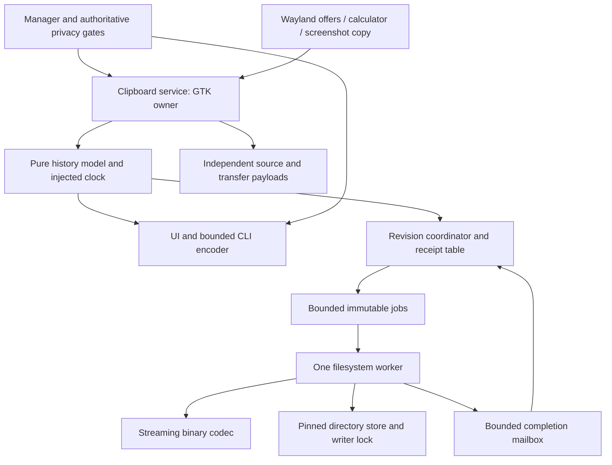

# Clipboard persistence: independent review and technical design

Date: 2026-11-01. Source: `4b8097add7de09647382fc6ae88c467ea832d473`.
Branch: `feat/clipboard-persistence`. Input: [functional specification](CLIPBOARD_PERSISTENCE_SPEC.md), version 0.1.0, read in full (1333 lines).
Status: proposed technical design for review; implementation is not authorized by this document. The 300-second startup tolerance remains **PROVISIONAL**.

## 1. Authority, verification, and specification review

**Verified repository facts.** `AGENTS.md` requires Zig production code. The repository root, branch, and HEAD match the task. Initially, `git status --short` reported only the untracked specification; tracked and staged diffs were empty. The specification's `git diff --no-index --check /dev/null docs/CLIPBOARD_PERSISTENCE_SPEC.md` returned 1 with no diagnostics: differing content, no whitespace finding. No builds, tests, package preparation, Pearl/compositor execution, or clipboard interaction were performed.

**Functional authority.** The specification's 52 normative requirements are the functional contract supplied for this design, subject to the explicitly provisional clock decision. This review does not approve implementation or freeze that decision. Existing memory-only/clear-on-lock documentation describes the baseline and is superseded only for the behavior explicitly changed by the specification.

**Proposed decisions.** Module boundaries, APIs, format v1, queue mechanics, recovery commands, and memory bounds below are design choices within that contract. They are not claims about current capabilities. Section 15 identifies approval items.

### 1.1 Review result and gate

**PASS for proceeding to technical design. No unresolved CRITICAL or HIGH contradiction found.** All 52 requirement headings are unique. There are exactly 52 corresponding unique acceptance scenarios, 52 matching traceability rows, and 80 distinct proposed test IDs. Direct requirement, acceptance, and matrix test lists agree. This was a document consistency audit, not test execution.

| Severity | Finding | Resolution / consequence |
| --- | --- | --- |
| CRITICAL | None found | Blocking gate passes. |
| HIGH | None found | Blocking gate passes. |
| MEDIUM | “Trustworthy” wall input is not independently authenticated; the 300-second allowance cannot prove elapsed powered-off time (TIME-004..006). | Define trust as successful, valid local samples plus consistency policy; preserve the stated offline limitation. Ratification remains open. |
| MEDIUM | Acceptance scenarios are umbrellas, not executable case definitions. Boundary lists are incorporated, but fault interleavings and maximum-frame fixtures still need concrete cases. | Sections 12–13 specify these cases and map every requirement. No implemented coverage is claimed. |
| LOW | Exact retry/receipt spelling, health encoding, codec, and descriptor APIs are intentionally deferred by the specification. | Defined here; no specification edit needed. |

Every requirement has externally inspectable outcomes or a testable internal invariant. Resource limits use exact bytes; 604800 seconds is inclusive at expiry. Front recopy advances timestamp/sequence/revision, and PNG admission can remove text from the projection. Restore is never publication. Suspension has no durable-Clear call path. Removal acknowledgement requires ordered synchronization; failed or uncertain removal never becomes fabricated success. The single writer and bounded frame design below cover the two-process and 8192-byte gates. Sensitive hints and full privacy redaction remain mandatory. Plaintext and non-forensic deletion limitations are explicit.

### 1.2 Implementation evidence inspected

| Baseline source | Verified fact and integration consequence |
| --- | --- |
| `src/services/clipboard.zig` | `Entry` owns bytes; selected payload and four outgoing transfers have separate allocations. `setLocked`, registry/device loss and `stop` call destructive `clear`. Replace those lifecycle calls with suspension, leaving explicit Clear separate. Front duplicate currently does nothing; no timestamps exist. `copyText` and screenshot copy currently retain before publication; both need transactional preflight. |
| `src/services/clipboard_policy.zig` | Count is 20; payload limits are already 262144/8388608/16777216 bytes. UTF-8/NUL, MIME, PNG prefilter and UTF-8 preview policy are reusable. PNG sanitation uses GdkPixbuf in the service. |
| `src/config/io.zig:20`, `:69` | Bounded read uses pathname etags; replacement has a 131072-byte read cap. `atomic` writes a private temp, loops writes, fsyncs, renames/links, then reopens the parent path. A failed parent open can still return success. These entry points are insufficient for the clipboard store. Section 6 defines minimal extraction/reuse. |
| `src/ui/surfaces/manager.zig:533`, `:1997`, `:2180` | Full privacy gate combines session identity/readiness, logind, lock/request/preparation, activity inhibition and Polkit. Status calls privacy synchronization; mutation routing needs the same full gate. Calculator callback at `:521` calls `copyText`. |
| `src/services/lifecycle.zig:390` | PrepareForSleep updates the gate and notifies immediately. Retain this authority and notification ordering. |
| `src/services/capture.zig:291`, `:378`, `:406` | Existing conversion uses a task/application hold; completion owns cleanup. Screenshot copy uses add-then-select; replace with one transactional local-copy path. Preview cancellation remains separate. |
| `src/cli/protocol.zig`, `src/cli/server.zig` | Flat request schema, operation allowlists, 8192-byte limit, eight clients, five-second deadlines, synchronous handler. Reply size currently checks `frame.len - 1`, excluding newline. Deferred destructive replies and complete-frame checks are necessary. |
| `src/cli/options.zig`, `src/pearlctl.zig`, `src/aqueous/entities.zig:147` | Actual command parser/help, client timeout/output, and decimal-ID validation locations. Request ID is at most 20 ASCII decimal bytes. |
| `src/desktop/clipboard_capture.zig` | Capacity-dependent arrays, preview case folding, ID-based row targeting, scaled 160x96 PNG previews, and ID-only change hash. Use logical revision for rebuilds; clear derived data on suspension. |
| `docs/CLIPBOARD_CAPTURE.md`, `src/tests.zig`, `build.zig`, `scripts/test.py`, `scripts/test-suites.json` | Existing contracts and suite registration anchors. Existing privacy, publication, calculator and screenshot regressions must be retained with deliberate changed expectations. |
| `tests/integration/test_clipboard_capture.py`, `test_launcher_calculator.py`, `test_security.py`, `scripts/pearl_session.py` | Private-session fixtures already isolate HOME/XDG, buses, Wayland and PAM. Persistence fixtures must preserve only their private state across restart. |
| `build.zig:8`, `build.zig.zon` | Zig 0.17.0 is required. Use the repository's explicit allocators, `.empty` ArrayLists and Linux/libc syscall style; no older `std.fs`/writer recipes assumed. |

## 2. Architecture and ownership



Proposed new Zig modules under `src/services/`: `clipboard_model.zig`, `clipboard_clock.zig`, `clipboard_codec.zig`, `clipboard_store.zig`, `clipboard_persistence.zig`; proposed pure status encoder under `src/cli/clipboard_status.zig`. The service remains the only owner of Wayland objects. No GTK object or mutable model pointer enters the filesystem worker.

The main context owns the model, privacy epoch, logical revision, receipts and client waiters. One long-lived worker owns store descriptors, lock descriptor, codec scratch and active operation. Jobs contain fixed metadata and immutable reference-counted text blobs. Blob bytes never change after validation; an atomic reference count permits worker/main release. Final release securely zeroes the entire owned allocation before freeing it. Zeroing a shared blob on logical removal would corrupt worker or selected ownership and is forbidden.

Selected bytes and outgoing transfers keep independently owned copies, retaining the baseline behavior of Delete/expiry/eviction. This is a bounded exception to the history budget. History blobs, codec scratch, decoded staging, previews, folded queries and outgoing buffers all have explicit destruction paths. GTK/GdkPixbuf internal storage, allocator copies and filesystem caches cannot be promised erased.

## 3. Pure model and clock contracts

### 3.1 Data, invariants, and fallible mutation

`Kind = enum { text, png }` remains the policy type. `Entry` contains `id: u64`, `kind`, immutable blob reference, `last_copy: i64`, and `sequence: u64`. `Model` uses a fixed `[100]Entry`, length, `payload_bytes: u32`, next ID, next sequence, and logical revision (`u64`). Count and payload sum apply only to live rows, never to independent sources or worker references.

Invariants: nonzero unique never-reused runtime IDs; canonical payload uniqueness by kind/full bytes; nonnegative timestamps no later than current effective time; descending sequence and nonincreasing last-copy times from front to tail; count <=100; payload sum <=16777216; valid text or previously sanitized PNG; no arithmetic wraps. IDs are process-local and never serialized. Restored sequence/timestamps are preserved, new IDs assigned, next sequence is saved maximum +1. Exhausted ID/sequence/revision fails admission with `CounterExhausted` before publication or mutation and closes collection/exposure until restart; safe Clear and shutdown remain possible. At revision exhaustion safe Clear removes hidden memory/files without issuing a reusable accessible revision; status stays blocked until restart. No renumbering or silent wrap.

These are interface contracts, with concrete support types described immediately below; sketches are not implementation code:

```zig
pub const Stamp = struct { seconds: i64 };
pub const EntryKey = struct { instance: [16]u8, id: u64 };
pub const MutationError = error{
    OutOfMemory, InvalidPayload, Stale, CounterExhausted, ClockUntrusted,
};
pub fn init(alloc: std.mem.Allocator) Model;
pub fn deinit(self: *Model) void;
pub fn prune(self: *Model, now: Stamp) MutationError!Change;
pub fn prepareCopy(self: *Model, value: CanonicalView, now: Stamp)
    MutationError!PreparedCopy;
pub fn commitCopy(self: *Model, prepared: *PreparedCopy) Change;
pub fn abortCopy(prepared: *PreparedCopy) void;
pub fn prepareDelete(self: *Model, id: u64, now: Stamp)
    MutationError!PreparedRemoval;
pub fn prepareClear(self: *Model) MutationError!PreparedRemoval;
pub fn commitRemoval(self: *Model, prepared: *PreparedRemoval) Change;
pub fn restore(self: *Model, loaded: *LoadedText, now: Stamp)
    MutationError!Change;
pub fn textSnapshot(self: *const Model, floor: Stamp, projection: u64)
    MutationError!Snapshot;
pub fn find(self: *const Model, id: u64) ?EntryView;
pub fn nextExpiry(self: *const Model) ?Stamp;
```

All calls except final blob release occur on the owning main context. `CanonicalView` is a borrowed `{kind, bytes}`: text must pass policy; PNG comes only from service sanitation and carries validated dimensions. It cannot be constructed by the decoder. `EntryView` is borrowed until the next mutation. `Change` contains fixed arrays of removed IDs, text-projection-changed flag, and resulting revision, without payload copies. `LoadedText` owns up to 100 text blobs. `Snapshot` owns up to 100 references plus copied timestamps/sequence, floor and projection number, not pointers into the live row array. Its destruction releases references. No API returns a mutable payload slice.

Both preparation types also expose `snapshot(floor: Stamp, projection: u64) MutationError!Snapshot` over their **candidate** rows and `discard(self: *Prepared...) void` for aborted ownership. This is how the coordinator reserves the post-commit projection before local publication; taking `Model.textSnapshot` of the old live rows would be incorrect. `PreparedRemoval` carries its immutable operation kind and removed live IDs; Clear can be prepared without a time sample. `Model.prune` returns a dirty text projection flag even if persistence admission is currently fenced, so expiry can never be forgotten merely because no snapshot slot was immediately available.

`PreparedCopy` owns a candidate fixed row array and new blob if needed, identifies evictions/duplicate ID, reserves all counters and references, and records the base model revision. It changes nothing live. `PreparedRemoval` similarly owns a candidate array. On any prepare error the live model and caller input remain unchanged and all temporary ownership is released. Commit requires unchanged base revision, performs no allocation and cannot fail; it transfers prepared ownership and increments revision exactly once. Abort is idempotent only after marking the preparation consumed; calling commit twice is a programmer error. Service transactions do not yield or invoke change callbacks between prepare and commit. Pre-reserve coordinator metadata/snapshot references and independent source bytes before publication. Allocation failure therefore cannot evict old rows or leave publication successful without its accepted model event.

Expiry is a distinct maintenance transaction before admission/action lookup. `prune` uses fixed metadata, releases expired references and never allocates; its only errors are invalid clock/counter state, checked before changes. An unsuccessful copy may still follow independently due expiry, but cannot partially evict nonexpired rows. `prepareCopy` deduplicates exact bytes after expiry, preserves a live duplicate's ID, refreshes even the front row, then orders by new sequence. New insertion evicts the necessary tail rows after preparing the incoming blob. For PNG eviction, `Change.text_changed` is true whenever any text victim is removed. Restoring inserts no copy event, expires before exposure, rejects the entire load on invalid data, and assigns IDs only at atomic install.

### 3.2 Exact time policy and recovery

Clock interface: `Sample { wall_seconds: i64, boottime_ns: u64 }`; `Clock.sample(Sample) error{ClockUntrusted}!Stamp`; `Clock.start(sample, saved_floor: ?i64) ...`; injected sample provider in the service adapter. Linux uses `CLOCK_REALTIME` whole epoch seconds and `CLOCK_BOOTTIME` nanoseconds, including suspend. Both failures, negative wall values, elapsed reset and checked arithmetic overflow close time trust. [Linux clock semantics](https://man7.org/linux/man-pages/man2/clock_gettime.2.html) support this choice; no NTP-status inference or clock adjustment occurs.

Maintain effective time internally as checked `i128` nanoseconds. At each sample, set `effective_ns = max(wall_seconds * 1000000000, previous_effective_ns + elapsed_ns)`. `Stamp.seconds` is its floor division by 1000000000; fractional carry survives every sample. Retained `last_copy` values are integer effective seconds. Expiration is checked subtraction `now - last_copy >= 604800`; if a timestamp is inconsistent, fail trust rather than clamp it. Schedule the earliest expiry, plus a wall sampling dispatch at most 60 elapsed seconds apart; after delayed dispatch/sleep every API samples/prunes before exposing anything. No outgoing send creates a copy or renews lifetime.

At startup, let `F` be a valid stored floor, `W` the valid local wall sample and `D = F-W` in checked wide arithmetic. If `D > 300`, withhold the entire model and report `clock_untrusted`/`ClockUntrusted`. If `D <= 300`, seed time with `max(W,F)` and preserve record times. No restore timestamp is refreshed. Saved floor advances on each successful snapshot; while text remains, schedule a coalescible floor checkpoint every 60 elapsed seconds when its floor advances, including during privacy suspension if trust remains valid. A blocked worker cannot guarantee checkpoint durability: the last successfully stored floor, not the last sampled time, is the restart floor. Empty projection removes the file; there are then no retained entry ages requiring a floor.

On clock failure, atomically invalidate automatic publication admission, hide model and derived metadata, disconnect collection and cancel publication/transfer work. A worker already admitted to rename/unlink must finish into a fenced uncertain result; queued snapshots cannot resume automatically. Keep the saved bytes and original timestamps. Correction alone does not reopen access. `clipboard retry` explicitly validates privacy, filesystem, exclusive lock, codec, clock and all retained timestamps. Startup retry rereads the unchanged file. Runtime retry requires a new valid wall sample no more than 300 seconds behind the maximum of in-memory trusted effective floor and stored floor; it resets the boottime origin only at this explicit recovery, seeds at that maximum/wall, prunes and resumes without publication. If the store changed unexpectedly, fail revalidation rather than merge hidden memory with disk. Individual Delete returns ClockUntrusted; safe Clear does not invent a timestamp and may remove the file if privacy/filesystem/lock checks pass. If no valid clock exists after Clear, collection remains disabled until retry.

| Fake startup inputs | Expected test result |
| --- | --- |
| `F=1000000`, `W=999701` (299 behind) | Restore using 1000000; timestamps unchanged; no publication. |
| `F=1000000`, `W=999700` (300 behind) | Same acceptance, inclusive boundary. |
| `F=1000000`, `W=999699` (301 behind) | ClockUntrusted; no payload exposure, collection, rename, unlink, backup or automatic repair. |
| Above 301 case, correct W to 999700 without retry | Remain withheld. |
| Above corrected case, explicit retry with all other gates valid | Restore at floor, prune exact age boundary, reconnect with initial-selection skip. |
| Any allowed skew, entry at `F-604799`, then one elapsed second | Present initially, absent at exact 604800 age; never renewed by load/retry. |

Benefits: rollback cannot rewind effective age within a run; small startup corrections do not rewind the saved floor; large unexpected future state is preserved for investigation/recovery. Limitations: no trusted powered-off duration, stalled/failed floor saves, repeated restarts, bad-but-consistent wall samples and a false forward jump remain possible; a forward jump expires early permanently. This does not promise seven real UTC days under an adversarial clock. Alternatives: zero skew (safer withholding, more false positives); larger skew (availability but more ambiguity); always clamp any rollback (silent indefinite withholding of expiry progress across restarts); erase on rollback (destructive and forbidden); authenticated external time or hardware time (new dependencies/trust outside scope). **300 is proposed for compatibility with TIME-005, pending final approval.**

## 4. Binary snapshot format v1

One complete unencrypted binary file, text only. All integers are fixed-width little endian, serialized explicitly using `std.mem.readInt`/`writeInt`; never dump a Zig struct with padding. Magic is eight bytes `50 45 41 52 4c 43 48 00` (`PEARLCH\0`). Header is 96 bytes:

| Byte offset | Size | Field and exact validity |
| --- | --- | --- |
| 0 | 8 | Magic above |
| 8 | 2 | Version = 1 |
| 10 | 2 | Header size = 96 |
| 12 | 4 | Flags = 0 |
| 16 | 4 | Text record count N, 0..100 |
| 20 | 4 | Reserved = 0 |
| 24 | 8 | Sum P of UTF-8 payload lengths, <=16777216 |
| 32 | 8 | Record area size R = P + 24*N, checked |
| 40 | 8 | Signed i64 effective epoch-second floor F, >=0 |
| 48 | 8 | Maximum sequence S among records; 0 iff N=0 |
| 56 | 8 | Reserved = 0 |
| 64 | 32 | Raw SHA-256 digest |

Each record, in front-to-tail text order: offset 0 `u32 payload_len` (1..262144); offset 4 `u32 reserved=0`; offset 8 `i64 last_copy>=0`; offset 16 `u64 sequence>0`; offset 24 exactly payload_len raw UTF-8 bytes, no terminator, padding, compression or per-record extension. No kind tag exists: every record is text. No preview, runtime ID, instance, PNG, receipt or path is stored.

SHA-256 covers bytes 0..63 concatenated with the entire record area; the digest field itself is excluded. Both header metadata and raw text are covered. Reuse the existing standard-library SHA-256 algorithm used by config I/O; store raw 32 bytes, not config's 64-byte hex rendering. This is accidental-corruption detection, not authentication against a same-UID writer.

Maximum record is 262168 bytes. Exact maximum v1 file is `96 + 24*100 + 16777216 = 16779712` bytes, below the specification ceiling 16842752. This is reachable with 100 nonempty texts sharing the aggregate budget. Writer removes the authoritative file for an empty projection; decoder may accept a correctly encoded zero-record fixture but does not generate one. An existing zero-length file is corrupt, not missing.

Decode on the worker, using at most 65536-byte scratch and exact-size owned blobs; no whole-file serialization allocation. Check opened file type/size before reading; reject >16842752 at store boundary and >16779712 for supported v1. Validate fixed header, checked R/P/count/EOF size equality before record allocation; each record length must fit remaining declared bytes and remaining aggregate budget before allocation. Read exactly, validate UTF-8/no NUL, and hash incrementally. Enforce strictly descending unique sequence, nonincreasing timestamps in that order, every timestamp <=F, first sequence=S and actual sums equal header. Duplicate canonical text records are corrupt regardless of differing metadata. Use per-record hashes as an acceleration followed by exact byte comparison on hash matches. Exact EOF is mandatory: probe one byte after the declared record area and reject any trailing byte. Re-stat opened inode and compare identity/size/change metadata before accepting; no partial staging reaches the model. On any failure wipe staging and scratch.

Short fixed prefix/magic or malformed v1 is `corrupt`; recognized magic with an unknown version is `unsupported`, preserved without interpreting its record layout. Unsafe filesystem objects take precedence over codec classification. Unknown versions, flags or future headers are never “best effort” restored. For v1, unknown flags/header size/reserved bits are corrupt; future incompatible features use a new version. Future readers may support multiple complete decoders; migration requires full validation followed by a separately durable publication, never automatic destructive conversion by an older reader. Baseline has no snapshot migration.

Codec APIs are `validateHeader([96]u8, observed_size) DecodeError!Header`, `decode(allocator, *ByteReader) DecodeError!LoadedText`, `encodedSize(*const Snapshot) EncodeError!u64`, `digest(*const Snapshot) EncodeError![32]u8`, and `encode(*const Snapshot, *ByteWriter) EncodeError!void`. Reader/writer are injected bounded callbacks with `read`, `writeAll` and error outcomes; no filesystem or GTK dependency. Digest is a first streaming pass over immutable references, then encode a second pass with finalized header. Writer loops short writes and retries EINTR; zero write is failure. Decode errors include Truncated, Corrupt, Unsupported, TooLarge, OutOfMemory and ReadFailed, mapped to bounded health codes without contents.

## 5. Persistence state machine and admission

Health and privacy are separate state machines. Health uses the exact internal tags below, plus a bounded reason code and a `trusted` boolean. `unsafe/unavailable` is represented as `failed` with `trusted=false` and codes such as UnsafeStore, InvalidStatePath, StoreUnavailable or CounterExhausted. This retains the required health distinctions without pretending every failure permits collection.

| Health tag | Meaning | Collect / select / expose with privacy open? | Normal writer admission |
| --- | --- | --- | --- |
| `unloaded` | Not loaded, load in progress, or deferred locked startup | No | Load/validation only; never startup-empty save |
| `ready` | Complete/missing load; latest requested projection durably settled | Yes | Ordinary snapshots and removal barriers |
| `pending` | Valid store with a newer projection or barrier outstanding | Yes | Serialized queue rules |
| `failed` | Known failure before irreversible step | Yes only for an already admitted model and `trusted=true`; otherwise hidden/disabled | Ordinary later complete projection may retry; removal-failure fence requires explicit retry |
| `uncertain` | Publication/removal may have changed the file without required confirmation | Yes only if existing path/format/time/lock trust still holds; otherwise hidden/disabled | Fenced: explicit retry/revalidation only |
| `busy` | Nonblocking writer lock lost, code StoreBusy | No, both text and PNG | No store load, write, cleanup or takeover |
| `corrupt` | Safe file, invalid supported snapshot | No | Safe explicit Clear or explicit reread only |
| `unsupported` | Safe file with unknown version | No | Safe explicit Clear or supported replacement followed by retry |
| `clock_untrusted` | Missing/reset/overflowed clock or rejected startup skew | No | Safe explicit Clear; validated retry |

Collection also needs the full existing privacy predicate, validated initial load and a valid device. UI can show an already loaded model while the data-control device is initially connecting only if session/privacy/device trust remains valid; actual device loss is a suspension and hides it. No health state overrides a closed privacy gate. Clear can bypass payload-format/time trust, never privacy, ownership, lock or path trust. Delete cannot bypass time or accessible-model checks.

Transitions are deterministic:

| From / event | To / action |
| --- | --- |
| New process, privacy closed | unloaded; defer payload read and store initialization until permitted |
| unloaded + successful safe load/missing file | ready; prune before install; pending if cleanup/checkpoint required |
| Any opening attempt + lock EWOULDBLOCK | busy; close losing descriptors, retain no loaded payload |
| Load/revalidation invalid format/version/time/path | corrupt / unsupported / clock_untrusted / failed-untrusted; no automatic mutation |
| ready/failed-trusted + accepted text-projection change | pending, unless a removal/uncertainty fence is active; then retain failed/uncertain with unsaved flag |
| pending + successful older write completion | Advance only that job's confirmed projection; remain pending if a newer projection/barrier exists |
| pending + latest success and queue empty | ready |
| Active operation fails before publication | failed; preserve admitted live state; removal failure installs fence |
| Active operation fails at/after possible rename/unlink | uncertain; fence subsequent writes |
| Any trusted state + detected store/time trust failure | Corresponding blocked state; invalidate trust epoch and queued automatic admission |
| blocked/fenced + explicit retry | Revalidate off-thread; stay blocked until all checks and any repair barrier succeed; then ready/pending |
| Safe Clear succeeds | ready if clock and other trust valid; otherwise retain blocked reason with empty model/store |
| Privacy closes/opens | Health retained; hide/revoke immediately; reopen only after composite privacy and expiry checks |
| Shutdown starts | Separate stopping flag; no new collection, publication or requests; drain eligible work without creating teardown snapshots |

Precedence for reporting is privacy redaction first, then busy/unsafe/unsupported/corrupt/clock-untrusted, then uncertain/failed/pending/ready/unloaded. Preserve internal reason information without exposing file paths. On a simultaneous codec and clock fault, codec is checked first; malformed bytes are corrupt rather than trusted future history.

## 6. Filesystem store and atomic-write reuse

### 6.1 Location, descriptors, permissions, writer exclusion

Resolve environment once from copied values on the main context, without filesystem I/O. Nonempty absolute XDG_STATE_HOME wins. Unset/empty/relative XDG_STATE_HOME uses absolute HOME plus `.local/state`. Missing/relative HOME when fallback is needed fails InvalidStatePath. NUL, `..`, empty interior components, overlong components (>255 bytes), or a resolved full path >=4096 bytes fail; permit a trailing slash and single `.` components by lexical removal before traversal. An absolute but unsafe XDG path is an error, never a fallback. Target suffix is exactly `pearl/clipboard/history.bin` and `pearl/clipboard/writer.lock`. Tests always inject an absolute private root; there is no implicit real-HOME default in store test constructors.

Worker opens `/` then walks each component with `openat(parent_fd, component, O_RDONLY|O_DIRECTORY|O_CLOEXEC|O_NOFOLLOW)`, validating the descriptor with statx/fstat, never concatenating paths for operational syscalls. Retain at most 256 ancestor descriptors (path-length bound) and the parent/child device+inode identities for revalidation. Reject symlinks at every level, non-directories, unexpected mount/identity replacement, and unsafe writable ancestors. Existing ancestors must be root- or current-UID-owned; group/other writable ancestors are rejected except root-owned sticky directories such as `/tmp`, where other users cannot rename this UID's child. Existing XDG base ancestors need not be 0700. Store-created directories, `pearl`, and `clipboard` must be current-UID-owned and exact 0700, including no special permission bits. Newly created missing path components use 0700, then validate via descriptors. Do not chmod/chown existing objects.

Because umask can remove owner bits, creation uses mkdirat/openat with private initial mode, then fchmod **only on a newly exclusively created owned object**, followed by descriptor validation, to establish exact 0700/0600. Never change process umask or repair existing permissions. A failed create/validate/sync is reported; do not recursively delete new ancestors as rollback. Newly created directory links must be synchronized bottom-up: fsync child and its pinned parent before any mutation is acknowledged, including all newly created XDG fallback components. Sync errors never downgrade to warnings.

Use `openat` with NOFOLLOW, CLOEXEC and NONBLOCK before type validation for history/lock/temp; no O_TRUNC on an existing object. Require current UID, regular type, exact 0600 (mode & 07777), and nlink=1 before content access or replacement. A named file is opened once and all reads/stat checks use that descriptor. History leaf must still match its expected identity before publish/removal. Missing history is recorded as an expected absence; a surprise leaf is a conflict requiring revalidation. Unsafe objects are neither read nor overwritten nor unlinked by “cleanup.”

Create `writer.lock` with O_CREAT|O_EXCL 0600; on EEXIST open without creation and validate. Acquire `flock(LOCK_EX|LOCK_NB)` on that stable inode before reading history or cleaning temps; recheck directory entry versus locked descriptor immediately after locking and before each publication/removal. Preserve lock inode forever, including Clear and ordinary shutdown. Also take nonblocking advisory flock on the pinned clipboard directory before opening/creating the lock file, to serialize cooperating processes during lock-inode validation. Acquire directory then file in that order; contention at either is StoreBusy. All Pearl versions implementing this format follow this protocol. The directory lock supplements, never substitutes for, required writer.lock ownership.

The loser closes descriptors and does not inspect history contents, clean temps, collect PNG/text, publish history, poll for takeover, or affect external selections. Explicit retry performs the entire protocol. SIGKILL releases held descriptors/locks; a new process must still validate everything. Do not unlink a “stale” lock based on PID or age. [Linux flock semantics](https://man7.org/linux/man-pages/man2/flock.2.html) justify lifetime-by-open-description locking; it is cooperative exclusion, not protection against malicious same-UID software.

### 6.2 Identity and race contract

All read/create/rename/unlink/enumeration/fsync calls use the pinned directory descriptor. Revalidate stored ancestor links, directory mode/owner, lock identity, history identity and trust epoch before entering publication; revalidate identity after the mutation and required sync before acknowledging. If a parent path is replaced, operations may finish within the already pinned original directory but must not follow the replacement or earn a success for a different store. Detected replacement fences the writer and closes collection. `fsync` uses the same pinned containing descriptor as rename/unlink, never a reopened pathname. Open descriptors remain references to their original objects even if names change; see [Linux open/openat rationale](https://man7.org/linux/man-pages/man2/open.2.html).

A precheck plus unlink/rename is not an atomic “unlink only this inode” primitive on Linux. The directory is private and only the serialized cooperative writer is authorized to mutate its leaves. Descriptor anchoring prevents redirection by ancestor swaps, and leaf swaps fail validation or unlink a name without following it; it cannot provide isolation from an adversarial same-UID/root actor replacing names at the exact syscall boundary. That actor is explicitly outside the specification's isolation guarantee. Tests exercise swaps at every injected seam and assert no target traversal, no unrelated payload access, and no false acknowledgement. If protection against malicious same-UID directory mutation were required, this specification would need a stronger isolation boundary; repeated stat checks must never be described as solving that threat.

### 6.3 Publication, removal, temporary files

Ordinary write protocol, entirely on worker:

1. Validate immutable projection bounds. Sample the worker's validated clock lease, set the local saved floor to its resulting effective time, and prune a worker-local snapshot view without renewing timestamps. Compute the streaming digest over that actual view/header. Completion carries the actual saved projection identity/floor and skipped expired IDs. Main context prunes independently before any exposure. Revalidate time/store trust before publishing; if another entry expired while encoding, discard the temp and regenerate the filtered view before rename. If no text remains, use the synchronized unlink protocol rather than emit a zero-record file. This can repeat under extreme I/O delay without issuing a false acknowledgement.
2. Recheck pinned store/lock/history identities. Create `history.tmp.` plus exactly 32 lowercase cryptographic hex digits using openat O_WRONLY|O_CREAT|O_EXCL|O_CLOEXEC|O_NOFOLLOW 0600. Retry random collisions at most 8 times, then fail; never reuse an existing temp. Exact-pattern temp names are 44 bytes. Validate the newly owned descriptor/mode/nlink.
3. Stream header/records with 65536-byte scratch; handle EINTR/short writes, fail on zero write. Verify expected length and descriptor metadata, fsync the temp descriptor, then close successfully. Close failure before rename is failed, not published. No content is written to history.bin in place.
4. Enter the publication admission described in section 7. Recheck history expected identity/absence and immutable authorization. Renameat temp to history.bin within the same pinned directory. A syscall known not to have performed rename is pre-publication failure on supported local filesystems; ambiguous remote/error outcomes are uncertain. Never infer rollback from an error alone on an unverified filesystem.
5. Fsync pinned clipboard directory; perform identity revalidation and all required new-directory link syncs. Only then emit durable completion for the actual snapshot. On post-rename error emit uncertain, retaining that the prior file may already have changed. No attempt to restore the old file as rollback.
6. Release scratch/blobs after reporting. On known pre-rename error, remove this operation's validated temp through unlinkat and fsync directory. Cleanup failure is recorded separately, blocks any Clear acknowledgement needing those temps, and must not conceal publication outcome. Failed/uncertain temps are never authoritative.

For empty projections, validate and unlinkat history.bin if present, then fsync the pinned directory even when the expected file is already absent. Only safe absence plus required sync is durable; absence alone is not proof about a prior operation. Individual Delete uses replacement for remaining text and unlink for the final text. Clear first waits for older active effects, invalidates pre-Clear pending work, then unlinks authoritative payload and all validated exact-pattern temps, syncing every changed directory before completion. Empty directory and locks remain.

Startup may incrementally clean validated temps after locks are held; never promote/read their payload. Iterate directory entries in worker batches of at most 128, retain only a fixed directory buffer and one name/descriptor, and check stop/trust flags between batches. Unrelated names are ignored. Unsafe exact-pattern objects are preserved and reported UnsafeTemporary; Clear cannot claim full payload cleanup while they remain. After unlinking entries, rescan until a complete pass finds no matching owned temp; handle directory-iteration changes without assuming offsets make deletion exhaustive. A cooperative writer creates no concurrent temp during Clear. Potentially unlimited preexisting clutter can make cleanup slow, but cannot create an unbounded name list; ordinary collection need not wait for unrelated-name scanning after a valid load. Clear latency has no fixed bound.

### 6.4 Precise reuse of `src/config/io.zig`

Do not call current `read`, `replace`, `mkdir`, or `atomic(path, ...)` for clipboard persistence. Path etags, GIO replacement, the 131072-byte cap, path temp creation, final-only NOFOLLOW, parent reopening and ignored parent-open failure do not satisfy this design.

In a future authorized implementation, minimally extract the existing `atomic` write-loop/fsync/publication mechanism into an additive descriptor-based primitive in `src/config/io.zig`, leaving current path API behavior separately reviewable for its existing callers:

```zig
pub const PublishOutcome = union(enum) {
    durable: FileIdentity,
    failed: Failure, // contains phase, errno class and cleanup status
    uncertain: Failure,
};
pub fn atomicAt(dir_fd: c_int, temp: TempName, target: [:0]const u8,
    input: *ByteProducer, admission: *PublicationAdmission,
    sys: *const AtomicSyscalls) PublishOutcome;
```

`atomicAt` owns only its exclusively created temp descriptor/name until return. Caller owns pinned directories and lock and supplies validation/admission callbacks. It reuses the existing write-until-complete, private file, content-fsync, atomic rename and directory-fsync sequence, with EINTR handling, exact modes, descriptor-relative syscalls, mandatory directory sync and phase-rich outcomes added. Caller handles pre/post identity validation and ancestor sync. Remove uses a parallel store routine with the same phase/outcome type. Existing screenshot/report path callers need no clipboard-specific semantics. If factoring requires changing their behavior, keep an additive primitive rather than silently changing those contracts. Reuse std SHA-256 directly rather than converting `io.digest`'s hex output back to bytes. This is a narrowly scoped extension, not a second path-based “safe” wrapper.

Fault injection uses a compile-time or constructor-supplied syscall table: openat, mkdirat, statx/fstat, fchmod-new, flock, read, write, close, renameat, unlinkat, fsync, directory iteration, random name generation and clock/admission checks. Record exact mutation phase and stable identities. Production exports no IPC fault-control operation; pure tests supply a fake table and filesystem integration tests supply private roots.

## 7. Background worker, revisions, barriers, and shutdown

### 7.1 Counters, queue and GTK integration

Maintain independent checked u64 counters: logical revision L (any accessible row/timestamp/order change), text projection P (text/timestamp/order/floor request), job serial J (every storage job), trust epoch E, and barrier epoch B (Clear ordering). Runtime instance is 128 random bits from getrandom before exposing identities; entropy failure makes collection unavailable. Completion carries `{instance, J, E, B, requested_P, actual_saved_P, floor, phase, outcome, operation_token?}`. Persisted copy sequence is not P/L/J. A worker-pruned snapshot gets an actual projection descriptor recording its filtered sequences; never call the newer live projection durable just because an older filtered job finished.

Projection content identity is the exact ordered vector of `(blob identity, last_copy, sequence)`, with a separate minimum requested floor, held in fixed metadata; compare the vector, not a possibly colliding hash. `actual_saved_P` equals requested_P only if the vector is unchanged and saved floor is at least that request's minimum floor; otherwise it is null with an attached filtered descriptor. A later valid floor strengthens that same job's clock checkpoint without refreshing any entry. Main allocates a fresh P for a subsequent desired descriptor rather than letting worker code increment main-owned counters. A completion still cannot confirm a different, newer requested P, even if its bytes happen to match. For clock checking the worker receives `ClockLease { effective_ns:i128, boottime_ns:u64, trust_epoch:u64 }` copied under the short mailbox lock, then uses its own injected sample provider and checked max/elapsed calculation. It never mutates the main clock object. A bad worker sample revokes publication and reports ClockUntrusted; a main-side epoch revocation invalidates all leases. Floor validation for latest-save status compares the saved floor against the requested floor, not a later incidental status sample.

The coordinator preallocates 32 removal slots, 64 completed-receipt slots, one active-job slot, one ordinary pending slot, one control slot and one completion slot. Jobs are immutable after admission; transfer ownership through a short mutex/condition-variable mailbox. Never hold that mutex across I/O, encoding, zeroing or GTK callbacks. `std.Thread.spawn` runs one filesystem loop; `std.Thread.Mutex`/Condition and atomic flags follow Zig 0.17.0 facilities. GMainContext completion delivery is an attached source reading a nonblocking eventfd (counter notifications only). Worker stores result then signals; EAGAIN still leaves a readable/pending result. Worker waits for main to consume the single completion before taking the next job, bounding completions and references. Main never waits for the worker.

Main context performs no path open/read/write/sync or binary serialization. Snapshot creation copies at most 100 metadata records and increments blob references; no 16 MiB payload copy on each copy event. Coordinator slot reservation is part of preflight and cannot fail after local publication has queued. One active operation plus one latest pending ordinary snapshot is allowed; pending ordinary replacement releases the previous references. Thirty-two outstanding removal barriers include any active removal; the 33rd is Busy before any row/source/transfer effect. When a removal arrives, discard an older pending ordinary snapshot and capture its post-removal projection as a distinct immutable barrier. Existing active work finishes first. Barriers execute FIFO; do not coalesce them in v1. Later ordinary snapshots sit behind all earlier barriers. New barriers can subsume a pending ordinary snapshot while keeping prior barrier identities.

Public coordinator operations: `requestSnapshot(Snapshot) !void` consumes snapshot only on success; `beginDelete(EntryKey) !OperationToken`, `beginClear() !OperationToken`, `query(instance, token) !ReceiptView`, `retry() !OperationToken`, `suspend(PrivacyReason) void`, `resume() !void`, `consumeCompletion() void`, `beginShutdown() void`, `isDrained() bool`, `deinitDrained() void`. Removal and model preparation are orchestrated as one non-yielding main-context transaction; reserve receipt/job/snapshot before commit. Snapshots contain text only. Control retry/load/stop commands use a fixed reserved control slot and cannot starve behind a full ordinary queue.

### 7.2 Publication admission and stale completions

Trust is a short-lived admission decision, not a mutex held during fsync. Before each rename/unlink, worker checks the current store/time trust epoch, cancellation/fence flags, clock sample, expected lock/directory/file identities and job order. It atomically records `irreversible_entered(J,E)` under the mailbox lock, then releases the lock and performs the syscall. Main can revoke E without waiting. If revocation won first, cancel before mutation and wipe staged work. If admission won first, the operation may change the file and must be fenced/treated as potentially uncertain until completion and explicit revalidation. Privacy closure alone does not revoke store/time trust: previously admitted saves and expiry maintenance may finish while UI is hidden. It still immediately revokes clipboard publication.

An older ordinary write may finish after a newer copy or removal request. Completion can advance the known confirmed projection for its own job, never L or the pending newer P. Store current desired projection separately from latest confirmed descriptor. If J/instance/E mismatch, release completion ownership, preserve any possible disk-effect information, and request revalidation; do not overwrite newer health or receipts with success. This is not permission to discard evidence of a possible write. Clear increments B for subsequent jobs, but an older active job's completion still drains before the Clear unlink starts. No pre-Clear pending job survives queue invalidation. No worker may retain a privately replayable old job after completing a barrier.

### 7.3 Removal acknowledgement, failure and retries

Delete's logical point removes the selected live row immediately after preflight; it does not revoke independent source/transfers. Its barrier captures the remaining text projection and follows all older effects. PNG Delete still executes a barrier (write current text or sync validated absence), so acknowledgement orders past older relevant work. Clear's logical point removes every row, cancels transfers, revokes only Pearl's source and drops pre-Clear pending ordinary work. Its filesystem barrier unlinks all payload state before any later snapshot can publish. A genuinely later equal copy is a new entry with new ID and sequence, even if a removed blob still has worker references.

Removal receipt states: pending; durable; failed (known unsynchronized failure); uncertain (possible filesystem mutation). A live request waits asynchronously for its actual result. At 3 elapsed seconds since admission, if unresolved and privacy is open, reply non-success DurabilityUnknown with instance/token; do not cancel the operation. Use boottime for operation deadlines; sampling failures conservatively return unknown, never success. Server's five-second transport timer remains. If its socket expires or reply is lost, the worker and receipt still exist. Privacy closure returns Locked without token/details and removes the waiter; the receipt continues internally.

On a removal failure or any uncertain storage result, fence **all** subsequent automatic filesystem jobs. Release queued snapshot payload references; mark queued, unattempted removal receipts failed with PriorBarrierFailed (not durable or uncertain about an action never attempted). Preserve only the bounded current logical model, latest ordinary pending description, generic removal-repair obligation and whether a Clear cleanup remains required. Hidden victims never reappear in the model. Ordinary pre-publication save errors without a removal fence may be followed by later new complete projections; no tight automatic retry loop is permitted.

Explicit `clipboard retry` creates a **new** operation token after full revalidation. It does not replay any failed frozen snapshot or renew timestamps. If admitted in-process history is still authoritative and the on-disk identity matches the known outcome, repair uses the latest current text projection, including every intervening removal and genuine later copy. A failed/uncertain Clear leaves `needs_clear_cleanup`: repair first drains old effects, safely removes payload/temps and syncs, then publishes the current post-Clear projection if nonempty. Receipt success for repair requires all these steps. This prevents retry of Delete A from resurrecting B deleted afterward. Original failed/uncertain receipts stay factual; they may name the new repair token while retained, never silently change to durable on file absence. A process restart loses all receipt knowledge. If external contents/identity changed unexpectedly, remain blocked and require safe explicit Clear or external correction followed by retry; do not merge or overwrite unknown data.

Completed receipts retain only fixed metadata, no victim payload, preview or paths. Pending receipts cannot be evicted. Completion removes the token from the 32-slot outstanding set into a FIFO ring of the latest 64 terminal receipts. No time-based expiry is needed: the 65th completion evicts the oldest; exit discards all. Tokens are increasing nonzero u64 scoped by random instance, never reused. Unknown/evicted token in current instance returns OutcomeUnknown; prior instance returns StaleInstance; missing instance returns InstanceRequired. Retry tokens follow the same limits. Full outstanding set rejects before effects. Locked responses take precedence over token/entry membership validation.

### 7.4 Shutdown and restart

Stopping is distinct from suspension and durable Clear. Stop collection/local publication, cancel pipe watches/timeouts, release source/device, reject new requests, and keep live model and coordinator alive. Enqueue latest eligible projection only if a trusted loaded model has unapplied changes; do not serialize an empty model produced by destructor cleanup. Drain jobs/receipts through main-context callbacks under the application hold. A blocked or failed trust state performs no unauthorized repair on exit. Report failed/fenced persistence and release queued ownership safely; successful shutdown does not imply failed receipts became durable.

When worker reports idle/stopped and completion mailbox is consumed, join it (now nonblocking in practice), detach eventfd source, close descriptors/locks, destroy model/owned buffers, release application hold, then destroy service/manager. Worker never owns a raw callback pointer into a destroyed manager; its shared control block outlives the thread and source. A shutdown callback carries service lifetime epoch and cannot touch a freed UI. Do not detach a thread or free its buffers to meet an exit deadline. Blocking kernel I/O may require indefinite graceful waiting; forced process termination relies on OS teardown and loses unconfirmed work.

Restart acquires locks, validates only authoritative history.bin, checks clock, prunes, assigns a new instance and new IDs, and reconnects with initial skip. Temps never restore. No crash recovery replays pending publication or upgrades old receipts. A file can validly contain an unacknowledged newer snapshot; restore eligibility and knowledge of acknowledgement are different facts.

## 8. Wayland producers and privacy lifecycle

The ext-data-control connection remains GTK's connection, with GTK its only reader. `Offer` MIME accumulation remains bounded to eight records; exact PNG wins, then case-insensitive UTF-8 text MIME, then exact plain text. Scan every advertised MIME before receiving selection; any exact sensitive hint excludes the entire offer, including PNG. Never request hint contents. Primary offers never consume the initial regular-selection skip. Every new regular selection cancels the previous incoming read, even null/unsupported/sensitive selections. Keep one read, four writes, five-second boottime deadlines and 65536-byte nonblocking dispatch budgets.

Completed external capture: recheck privacy/device epoch/store/time admission, validate text or sanitize PNG, sample/prune, prepare model and coordinator projection, commit exactly one copy event, then notify. If any preflight fails, release input and create no event. A sensitive or cancelled offer cannot refresh an existing match. Source disappearance after complete capture does not delete history.

Explicit select/calculator/screenshot copy: validate privacy/current instance/live ID or input, validate canonical value, sample/prune, prepare model transaction and storage request, allocate independent source bytes, create source and advertise MIME **before** replacing the old source. Recheck all gates without yielding. Queue device.setSelection, commit the prepared event once, install new independent ownership, then destroy old source/payload and flush. Generated Wayland proxy request construction that can allocate must be included in preflight or use a prepared request/connection admission; if marshalling itself fails, abort before model commit and preserve the old source wherever no request has queued. Once selection request has queued, classify it as publication-queued success; later flush/connection failure is a publication health failure, no timestamp rollback or replay. Never promise actual paste. Existing generated bindings must be audited at implementation for fallible marshalling; no hidden allocation may be left between preflight and this commit point.

Calculator callback uses one copy-text transaction, not retain-then-select. Screenshot copy uses one sanitized-PNG transaction; existing large screenshot can remain independently saveable if rejected by clipboard limits. One local action increments sequence once. An eligible separately received self-offer is a separate capture event under the specification, not silently suppressed; it deduplicates and may refresh again. The original source sends independent bytes and cannot reinsert/refresh a deleted/expired/evicted row. Older source callbacks check proxy identity and close unused descriptors; stale cancellation cannot destroy the current source.

Restore, unlock, reconnect, retries, status, disk completion and paste send never call setSelection. On each reconnect set `skip_selection=true`; first regular event, including null, consumes it. No initial offer is imported. Every local API, incoming completion and outgoing send checks the full gate plus its privacy/device epoch. Source release sets selection null only when Pearl actually has its current source; external selections remain untouched.

### 8.1 Lifecycle transition table

“Retain” means expiry still applies under valid clock. “Maintenance” means only accepted work/expiry/floor work with valid store/time trust, no suspension-driven deletion. Revoke destroys local source ownership even if a dead connection cannot deliver release. All reasons compose; clearing one reason never overrides another.

| Event | Collection / visibility | History memory | Disk effects | Wayland source / transfers | Reconnection |
| --- | --- | --- | --- | --- | --- |
| Normal verified active | Enabled / visible after load | Retain bounded model | Text changes and floor maintenance | Normal / bounded | Existing device |
| Lock requested, preparing or authoritative lock | Disabled / hidden immediately on dispatch | Retain | Maintenance; never durable Clear | Revoke Pearl source / cancel all | Drop data device |
| Unlock | Disabled until every gate passes; then eligible rows visible | Prune before exposure | Maintenance | No publication / no replay | Fresh device, initial regular skip |
| Sleep preparation | Disabled / hidden | Retain | Maintenance | Revoke / cancel all, including capture job | Wait for active verified unlock; fresh device |
| Resume from sleep | Full gates and clock first | Prune including suspended elapsed time | Maintenance or clock block | No automatic source | Initial skip after allowed reconnect |
| Inactive/missing/unverified logind or session identity | Disabled / hidden | Retain | Maintenance | Revoke / cancel all | Only authoritative matched/active recovery |
| Polkit/authentication or activity inhibition | Disabled / hidden | Retain | Maintenance | Revoke / cancel all | Full gate after prompt/inhibition ends |
| Aqueous IPC loss/readiness loss/mismatch | Disabled / hidden | Retain until safe teardown | Maintenance if trust valid | Best-effort revoke, destroy ownership / cancel all | Verified IPC/native identity before fresh device |
| Wayland manager/device/seat loss | Disabled / hidden | Retain | Maintenance if trust valid | Destroy local ownership / cancel all | Fresh valid device when protocol returns; no replay |
| Second seat / ambiguity | Disabled / hidden for process lifetime | Retain subject to expiry | Maintenance | Revoke / cancel all | No same-process recovery, even if seat disappears |
| Startup locked/unverified | Disabled / unloaded and hidden | No restored payload | No payload read or empty overwrite | None / none | Full validation/load then initial skip |
| Busy / unsafe / corrupt / unsupported | Disabled / hidden | Existing memory hidden, no new rows | No automatic writes; safe Clear only with lock/path ownership | Revoke / cancel all | Explicit validated retry; busy loser never auto-takes over |
| ClockUntrusted | Disabled / hidden | Retain hidden without fabricated ages | No automatic mutation; safe Clear exception | Revoke / cancel all | Explicit validated retry |
| Shutdown | Disabled / hidden | Release only after worker references drain | Flush eligible current state; no teardown-empty save | Revoke / cancel all | None |
| Restart | Disabled until validated; text only | Fresh IDs/instance, no PNG | Load authoritative only; expiry cleanup | Never auto-publish / no replay | Initial skip |
| Explicit Delete | Full gate; victim hidden immediately | Remove victim; other rows remain | Ordered durable barrier | Preserve independent source / preserve independent paste | No reconnect required |
| Explicit Clear | Full privacy/path/lock gate; logical empty point | Remove all live rows | Ordered unlink + validated-temp cleanup + sync | Revoke only Pearl source / cancel all | Existing device may collect genuinely later events |

Service `changed(context)` notifications occur after model commit, expiry, health change, logical removal, terminal receipt and privacy changes. Do not call user callbacks while holding mailbox locks or halfway through source replacement. UI updates/redaction must run before waiting for surface reconciliation. Separate screenshot preview/saved-path feedback is cleared and conversion cancelled by existing capture.setLocked; late completion checks capture generation/cancel flag and remains discarded. No persistence reference retains a screenshot preview.

## 9. CLI, deferred responses and UI compatibility

### 9.1 Request and response contract

Preserve control protocol `pearl:1` and existing flat schema/session/display/peer-UID checks. Add only operation-scoped fields: `limit:?u8`, `instance:?[]const u8` (exactly 32 lowercase hex), `token:?u64`. Reuse existing `offset:?u16`, `revision:?u64`, `generation:?u64`. Reject null-present required fields, duplicate fields, extra fields, malformed types and overflows before handler dispatch. The parser must permit missing instance on legacy entry actions far enough to return the explicit InstanceRequired error, not reinterpret missing identity. Errors carry no copied request text except validated numeric correlation ID.

| Command | Wire operation / fields | Result |
| --- | --- | --- |
| `clipboard status [--offset N] [--limit N] [--revision R] [--instance HEX]` | clipboard_status; offset, limit, optional revision/instance | First/pinned page, health and capability object |
| `clipboard select --generation ID --instance HEX` | clipboard_select; generation, instance | Publication-queued outcome and persistence state, no payload |
| `clipboard delete --generation ID --instance HEX` | clipboard_delete; generation, instance | Deferred durable/failed/uncertain receipt, or DurabilityUnknown token |
| `clipboard clear` | clipboard_clear; no entry identity needed | Deferred receipt; affects Pearl's current history by explicit global intent |
| `clipboard result --instance HEX --token N` | new clipboard_result; instance, token | Pending/durable/failed/uncertain receipt; bounded non-success for unknown identity |
| `clipboard retry` | new clipboard_retry; no payload/path | Deferred repair/revalidation outcome with a fresh token; never publication |

Status adds `capabilities:{clipboard:2,pagination:true,instance_required:true,removal_receipts:true}`. New clients discover this through legacy-shaped status with no added request fields; older servers reject new fields/operations explicitly. Existing client `pearlctl` already prints arbitrary result JSON and does not enumerate entries internally. Retain existing available, locked, persistent, pending, message, entries fields. `pending` remains incoming-transfer only. `persistent` means text persistence enabled/owned after valid initialization, never acknowledgement that current text is saved. Generic privacy suspension can preserve persistent ownership; StoreBusy/invalid initialization cannot claim it.

Accessible status has `total,offset,limit,returned,has_more,next_offset,revision,instance,entries`, plus `health`. Defaults offset=0, limit=20; offset 0..100, limit 1..20. Limit describes requested page maximum; returned may be smaller for encoded budget. Offset >=total yields returned=0, has_more=false, next_offset=null. Otherwise returned>=1, next_offset=offset+returned when more remain. Revision pins the accessible model L; instance pins process identity. Supplied instance mismatch returns StaleInstance; supplied revision mismatch returns StaleRevision. Either can be supplied independently; callers should pin both for traversal. Expiry is run first and invalidates a stale pin. No snapshot pagination is retained server-side; the client restarts traversal after stale errors.

Entry fields remain id, kind, bytes, preview; add `last_copy` if exposed, using exact integer seconds. Never return full payload, pathname or persisted file details. Treat u64 JSON values as exact integers; clients that cannot retain their precision must not round and resubmit mutations. Select/Delete require current instance regardless of revision, so row reorder alone does not invalidate a live ID. Restored rows have new IDs and process instance. Clear/result/retry response formats are explicit; do not emit baseline unconditional success for a merely hidden row.

Health object (accessible) is fixed-schema: `state` (section 5 tags), `code` (bounded enum <=32 ASCII bytes), `trusted`, `unsaved`, `requested_projection`, `confirmed_projection`, and `removal_pending` count <=32. A confirmed projection is an observation about that exact worker result; it is not “current model saved” unless its text descriptor equals the current desired text descriptor and all barriers have settled. PNG-only changes can advance L while P stays unchanged. No payload hashes/paths/error strings enter health.

Receipts contain `{instance,token,kind,state,code,retry_token?}` and may contain requested/current projection numbers only while authorized. Terminal failed/uncertain responses use `ok:false` and this bounded receipt under `err.operation`; durable uses `ok:true,result.operation`. At the 3-second deadline use `ok:false,err.code="DurabilityUnknown",err.operation={instance,token,state:"pending"}`. A successful result query can return a receipt whose **operation** failed; query success means the query was answered. CLI must preserve that distinction and use a nonzero exit for failed/uncertain/pending removal outcomes, including result queries, while emitting the full JSON receipt. Missing tokens are OutcomeUnknown and never interpreted as absence of history.

### 9.2 Complete encoded frame bound and privacy races

Use an 8192-byte fixed output buffer for **complete** JSON envelope and newline, including all success/error/deferred forms. Validated correlation IDs are <=20 decimal bytes; fixed capability/health/message/error strings have bounded sizes. Reserve at most 2048 bytes for the worst-case non-entry envelope, health, pagination, capabilities and counters; enforce this in encoder unit fixtures and code constants. Preview uses existing 120-original-byte UTF-8 boundary and ASCII control substitution; escaping is measured after transformation. A conservative row budget is 1024 bytes (even treating every preview byte as six encoded bytes plus numeric/field overhead). At least one row plus the 2048-byte fixed allowance fits; therefore truncating a nonterminal page always makes progress.

Algorithm: first encode metadata and up to requested limit into bounded scratch; on overflow, decrement returned and re-encode with truthful returned/continuation until the complete frame fits. Never append partial JSON and never truncate serialized bytes. No rows plus an oversized fixed envelope yields a constant bounded ResponseTooLarge error (<=512 bytes including correlation ID and newline). All failures use this same bounded writer/fallback. Transport accepts only frame.len<=8192, replacing the baseline newline-excluding check. Assert completed frames end in exactly one LF and contain valid JSON/UTF-8. Measure every response family, not just status; parser's largest legal request ID is part of those fixtures.

Before status preparation, deferred completion, result query, entry lookup and final send, synchronize the **full** privacy gate. Closed gate status is generic: entries=[], total=null, has_more=false, next_offset=null; offset/limit/returned/revision/instance and all projection/receipt/count information are null or omitted. Redacted health is only `{state,code}` from a generic bounded allowlist; `message` is a generic suspension string. Known-token/entry actions return Locked **before membership/identity lookup**. Generic health is permitted by CLI-004, but must not contain file size, record counts, revisions, tokens or entry-dependent text.

Baseline `Transport.send` copies and queues output for later dispatch (`src/aqueous/transport.zig:74`), so a pre-encode gate check alone is insufficient. Clipboard CLI slots mark response sensitivity and privacy epoch. On gate closure, wipe any queued sensitive frame: if zero bytes were sent, replace with redacted status/Locked; if some bytes were already sent, close the socket and wipe the remainder (cannot safely splice a second JSON frame). Add an optional owner validation callback in Transport immediately before **each** output send for these slots, or an equivalent server-owned gated send path. Same-context source dispatch serializes this check with privacy-event processing. Bytes already handed to the kernel before closure are an external copy and cannot be recalled; do not claim otherwise. `wire.secure=true` wipes owned I/O buffers, and slot teardown zeros copied request identity/receipt metadata as appropriate. No new content is emitted after the privacy event is applied.

### 9.3 Deferred server ownership

Extend server handler result to `union(enum){ immediate: []const u8, deferred: WaiterKey }`, or add a dedicated deferred clipboard dispatch before the existing synchronous handler. A `WaiterKey` is `{slot_index:u8, slot_epoch:u64, instance:[16]u8, token:u64}`; copied request ID is fixed `[20]u8` plus length. Never retain the request arena, allocator result slice, socket raw pointer or UI row pointer. At most eight live socket waiters exist. Slot close increments checked epoch, detaches its receipt waiter and removes the 3-second timer without cancelling the operation. Completion and timeout callbacks validate slot epoch, operation identity and privacy before constructing a fresh bounded reply. A stale completion releases ownership but cannot answer a reused slot.

A received second request on a responding slot closes it, preserving one request/reply semantics. Three-second timer is relative to operation admission; if the existing five-second accepted-connection deadline is sooner because a client delayed sending its request, return DurabilityUnknown immediately rather than promise a later reply. Read/write stalls still follow transport deadlines. Shutdown detaches waiters with bounded unknown/Locked responses when possible, then drains worker independently of client lifetime. All new errors must be added to server's explicit error mapping; otherwise the current catch list would turn them into Internal.

### 9.4 UI and actual change locations

Future code changes are confined by responsibility, not performed here:

| File | Required future change |
| --- | --- |
| `src/services/clipboard_policy.zig` | Increase count to 100; retain payload/PNG/preview bounds. |
| `src/services/clipboard.zig` | Model/coordinator adapters, transactional copy, expiry, suspension/revocation separated from explicit Clear, instance-aware actions, status adapter. |
| `src/config/io.zig` | Add/extract descriptor atomic primitive from existing mechanism, preserving unrelated caller contracts. |
| `src/ui/surfaces/manager.zig` | Full-gate routing for every clipboard action, deferred handler, completion/privacy dispatch, calculator producer integration, startup/shutdown ownership. |
| `src/services/capture.zig` | Replace add-then-select with atomic local PNG copy; retain preview/conversion cleanup. |
| `src/desktop/clipboard_capture.zig` | Revision-driven rows, 100-entry navigation, pending/failed/uncertain removal feedback and Retry, safe Clear available for blocked payload trust when privacy/path/lock permit it. |
| `src/cli/protocol.zig`, `src/cli/options.zig` | New fields/allowlists/commands, parser bounds, help, explicit identity/capability rules. |
| `src/cli/server.zig`, `src/aqueous/transport.zig` | Deferred slot lifetime, full-frame bound, gate-aware queued output cancellation, secure buffers. |
| `src/pearlctl.zig` | New operation exit semantics and bounded result handling; preserve five-second transport deadline. |
| `docs/CLIPBOARD_CAPTURE.md`, affected translations | Deliberate wording changes in a future task: plaintext text persistence, memory-only PNG, seven-day retention and hidden-on-lock. Locate catalog references by source string; no unrelated translations changed. |

UI rows use live `(instance,id)` and logical revision, not array index or previous ID-only hash. Refresh on a front recopy, expiry, health and receipt change even if IDs/order do not change. Filter remains case-folded preview substring; no match removes nothing. A row disappears at logical Delete, with separate “Removal pending” feedback; do not label it permanently deleted until durable receipt. Clear follows the same feedback stages. Show Copy as publication queued, with separate save health. On privacy closure synchronously clear row labels, folded strings, filter query, PNG thumbnails, selection/cursor identities and per-operation feedback, then hide the view; retained model bytes remain private in memory. Reopening never publishes. Teardown of a view cannot cancel a durable operation or free its worker buffers.

## 10. Failure, crash and recovery matrix

“Changed?” refers to authoritative payload, not a private temp or logical model. Failed-before-publication means no known authoritative mutation; ambiguous kernel/remote outcomes are always escalated to uncertain. Durable success remains conditional on filesystem/device synchronization guarantees. [Linux fsync documentation](https://man7.org/linux/man-pages/man2/fsync.2.html) requires separate directory synchronization; neither rename visibility nor file fsync alone is an acknowledgement.

| Failure | Detection / affected state | User-visible outcome | Authoritative file might have changed? | Retry and restart recovery | Proposed test |
| --- | --- | --- | --- | --- | --- |
| ENOSPC on create/write | Syscall/phase; failed-trusted after admission | Copy remains accepted; unsaved, or removal failed | No before publication; yes/unknown if reported by later sync | Freeing space alone does not replay removals; latest-state retry; restart validates old/new eligible state | Inject each create/write/sync seam and assert no permission/alternate-path repair |
| EACCES | Open/create/rename/unlink fails; failed with trust depending on object validation | Generic PermissionDenied; never sensitive path | Usually no before syscall effect; uncertain at ambiguous mutation boundary | Explicit revalidation after correction; no chmod existing objects | Deny each operation on private filesystem; sentinel unchanged |
| Invalid UID/mode/type/nlink | Descriptor stat before read/mutation | UnsafeStore, hidden, collection disabled | No by validation refusal; already-admitted irreversible work may be uncertain | External correction or validated Clear only when filesystem becomes safe; restart rechecks | Every 0700/0600/special-bit/type/link boundary |
| Symlink/ancestor/path replacement | NOFOLLOW failure, saved identity mismatch or postcheck | UnsafeStore/Conflict; hidden and fenced | Pinned old directory may have changed; replacement is never followed | Explicit full revalidation; no old descriptors reused for a new store | Swap every ancestor/leaf before open/rename/fsync/unlink; target markers unread/untouched |
| EIO / short writes / EINTR | Write/read/close result; checked byte count | Failed before publication, uncertain where effect ambiguous | Short writes to temp do not change main; EIO at rename/sync can be uncertain | EINTR/positive short writes retry locally; other failures require proper recovery; restart never temp | Deterministic zero/short/error sequences, truncated stream |
| Temp content fsync failure | Before rename | Failed, no durable confirmation | Main unchanged if rename not entered | Clean validated temp; latest-state explicit retry or later ordinary snapshot | Fail first/last content sync, including close error |
| Directory fsync or required directory-link sync failure | After rename/unlink or first path creation | Uncertain if payload mutation occurred; otherwise initialization failed | Yes; no claim of rollback or durability | Fence, inspect actual file during explicit retry; restart accepts validated old/new/absent outcomes | Crash images before/after each sync; no invented success |
| Rename failure | Return plus recorded admission phase | Failed only if known not applied; otherwise uncertain | Not guaranteed unchanged on unverified/remote error | Preserve evidence; no rollback rename; revalidate before latest-state retry | Local known-no-effect error and fake applied-then-error |
| Concurrent writer | Directory/file flock EWOULDBLOCK | StoreBusy, no collection/exposure | Losing process does not change payload | Explicit retry after release; crash releases OS lock, stable inode remains | Two private processes and deterministic two-open race |
| Interrupted serialization | Worker error/crash before rename | No acknowledgement; failed/unknown | Main old/absent; temp may remain | Only main restores; temp never promoted | Stop at each record/header/chunk boundary |
| Corrupt snapshot | Length/text/checksum/ordering/EOF validation | Corrupt, hidden, no collection or automatic overwrite | No by load; trust-loss overlap uses uncertainty rules | Preserve bytes/digest; valid external replacement + retry or safe explicit Clear | Each field, duplicate, trailing data, checksum and length fuzz fixture |
| Unsupported snapshot | Magic known, version unknown | Unsupported, hidden; preserved | No automatic change | Updated compatible reader, corrected file + retry, or safe Clear | Future-version file byte-for-byte unchanged |
| Clock rollback/reset/overflow | Clock policy and saved-floor check | Runtime rollback advances effective age; invalid/301 startup => ClockUntrusted | No automatic change after trust failure except already-admitted uncertain step | Corrected inputs plus explicit retry; never restore-refresh | 299/300/301, nanosecond carry, reset, forward/reverse, suspension |
| Process crash / SIGKILL | No completion/receipt delivery | Prior caller outcome unknown unless already acknowledged | Old/new/absent according to exact crash boundary | New instance, lock acquisition, validate authoritative only; acknowledged removals cannot be undone by older jobs | Crash at each protocol phase, preserved private images |
| Forced shutdown / blocked fsync | Stop flag but kernel call not completed | No completed flush claim; graceful wait may be indefinite | Yes if irreversible step entered | Forced exit sacrifices pending work; restart same validation rules | Worker held at each blocking seam; verify buffers not freed while alive |
| Stale async completion | Instance/job/trust/barrier/slot epoch mismatch | No newer success or stale-client reply; possible disk effect retained as uncertain | It may have changed during its previously admitted step | Drain/fence before retry; never replay snapshot or infer old receipt | Completion permutations and slot reuse during shutdown/lock |
| Delete/Clear unlink failure | Unlinkat/identity/temp cleanup/sync result | Logical hidden state remains; failed/uncertain receipt | Partial Clear may have removed main or some temps | Explicit latest-state repair, include remaining validated temps; restart old eligible main may return before ack | Fail every unlink and each batch boundary |
| Clipboard publication preflight failure | Gate/device/allocator/source setup | Publication failed; old source and nonexpired order preserved | No new snapshot from failed event | New explicit action only; never queued retry publication | Allocation/source/device failures; old receiver still pastes |
| Clipboard flush/disconnect/paste failure after queue | Connection/source/send events | Publication queued was accepted; later failure shown separately | Its text event may independently persist | No timestamp rollback/replay; lifecycle suspension applies | EPIPE, early receiver exit, source cancel and device loss |
| Completion notification failure | Eventfd write/read failure, mailbox still owns result | Coordinator unavailable/fenced; no fabricated acknowledgement | Worker may have completed publication | Keep control block/application alive; use existing main-context wake fallback once, then orderly stop if delivery cannot be restored | Saturated eventfd and injected permanent failure; bounded mailbox |
| OutOfMemory | Model/source preflight or worker decode/metadata reservation | Reject before effects, or failed save if admitted earlier | No for preflight; phase decides later worker error | Release/zero owned staging; no partial load or eviction | Failing allocator at every owned allocation |

Never convert uncertainty into “definitely rolled back” or “definitely durable.” Retrying fsync can establish a new synchronization fact after validating the actual state, but cannot prove a prior caller received acknowledgement. Prior durable-revision status is historical evidence, not assurance that later uncertain writes left that file unchanged.

## 11. Resource, responsiveness and security bounds

All numbers below are bytes unless stated otherwise. Define H=16777216 (history budget), I=8388608 (PNG encoded bound), T=262144, N=100, O=32 (outstanding removals), D=64 (terminal receipts), S=65536 (worker scratch). These are logical owned-byte bounds, not allocator bookkeeping or total RSS guarantees. Immutable reference sharing normally uses substantially less than the conservative disjoint-payload worst case.

| Resource | Bound / formula | Enforcement |
| --- | --- | --- |
| Live retained payload | H = 16777216 (16 MiB) | Model commit sum, both text and PNG |
| Immutable projection payload references | <=(O+2)*H = 570425344 (544 MiB), before sharing | Up to 32 barrier snapshots, one active ordinary job, one latest pending ordinary job; active barrier counts within O |
| Live plus worker-retained projection payload | <=(O+3)*H = 587202560 (560 MiB) | Finite queue and exact immutable blobs; only text is in snapshots |
| Prepared new canonical input | <=I = 8388608, or T for text | One no-yield candidate at a time; duplicate abort releases it |
| Load/revalidation staging | <=H plus S | Not admitted concurrently with queued snapshots; drain/fence first. Existing hidden model may coexist with staging |
| Persistence serialization buffers | S + 96 + 24 plus hash state; no H-sized encoded buffer | Two-pass digest/streaming encoder |
| File size | <=16779712 v1; reject any input >16842752 before parsing | Checked header size and exact EOF |
| Ordinary queue | One active plus one latest pending, with <=32 removal jobs | Fixed slots; no task per copy, no unbounded GTask queue |
| Snapshot metadata | At most 34*100 records | Cap each in-memory snapshot record at 64 bytes via size assertion: <=217600 bytes plus fixed job headers |
| Receipts | 32 outstanding +64 terminal | Each metadata record <=256 bytes by size assertion: <=24576 bytes; no payload references in terminal receipts |
| Independent selected bytes | <=I | One separately owned selected payload |
| Outgoing bytes | <=4*I = 33554432 | Four immutable transfer allocations |
| Incoming raw bytes | <=I (T for text) plus one 65536 stack buffer | Pre-reserve exact capped storage / bounded growth; cancel on next selection |
| PNG filtered input and encoded output | <=I each | Bounded prefilter and callback encoder, described below |
| One decoded PNG pixel plane | `rowstride*height <=4*w*h <=33554432` for allowed RGB/RGBA 8-bit PNG, checked actual stride/allocation | Revalidate decoded format/dimensions; library workspace is separate |
| UI thumbnail pixels | <=100*160*96*4 = 6144000 | Existing at-scale 160x96 decode; validate actual returned dimensions/stride |
| UTF-8 preview strings | <=100*(120+1)=12100 | Existing boundary policy; folded string output separately capped at 1024 per row |
| UI filter query | <=4096 original UTF-8 bytes; folded <=16384 | Reject excess edit rather than grow indefinitely; no history mutation |
| CLI output | <=8192 each, at most 8 queued frames =65536 | Complete-frame bounded encoder, secure transport output |
| Directory scanning | <=128 entries/batch, fixed name <=255 plus NUL | Incremental iterator, no collected name list |
| Path descriptors | <=256 ancestor descriptors plus fixed leaf/temp/event descriptors | 4096-byte lexical path bound and explicit component-count check |

Capacity refers to owned allocation size as well as used length: do not permit ArrayList geometric growth above these caps and claim a bound based only on `.items.len`. For incoming data, reserve the applicable maximum once or use capped exact growth; move ownership into canonical text where possible. Cleanup zeroes all owned capacity, including unused tail, not merely bytes currently visible. Reallocated plaintext blocks require explicit allocate/copy/zero/free rather than opaque realloc if old ownership would otherwise be released unwiped.

The queue bound is intentionally conservative: 32 disjoint full text projections behind a blocked disk can pin 512 MiB by themselves. This is a material design cost, not hidden within the 16 MiB history limit. It meets the functional queue/receipt contract without losing individual removal proofs. Do not add additional frozen snapshots for clients, completion history, every heartbeat, or automatic retries. If a smaller memory ceiling is required before implementation, a proof-preserving barrier coalescer needs separate design review; silently dropping barriers is forbidden. Allocation failure during a new barrier's preparation is a nonmutating error. The fixed limit does not guarantee an allocation will succeed under memory pressure.

PNG sanitation retains existing prefilter, explicit PNG decoder, fresh-pixel re-encoding and limits. Use a clipboard-only bounded `saveToCallbackv` sink, failing before append if output would exceed I, rather than creating an unlimited saveToBufferv result and checking afterward. [GdkPixbuf's callback API](https://docs.gtk.org/gdk-pixbuf/method.Pixbuf.save_to_callbackv.html) supports chunked output/error propagation. Preallocate at most I for this sink; do not change general screenshot Save behavior or prohibit independently saveable larger screenshots. Prefilter uses a bounded exact-capacity buffer no greater than input I. Check decoded pixels against original validated IHDR and allowed positive dimensions before constructing the fresh image. A fresh pixbuf wrapper references the same pixel plane, not a promised second allocation. Library/libpng compression/decode workspaces, GTK texture copies and screenshot pipeline buffers are outside Pearl-owned clipboard caps and have no proven total allocation ceiling here. Screenshot conversion already allows a 41943040-byte capture allocation plus <=25165824 RGB bytes; its encoded preview may exceed the clipboard cap, as required by independent Save behavior.

Taking a deliberately additive conservative clipboard-owned envelope for the disjoint-snapshot case: 35H + one candidate I + five independent output/source copies 5I + incoming I + filtered I + sanitized output I + decoded plane 4I + thumbnail planes 6144000 + scratch S is 702464000 bytes (about 669.92 MiB), before fixed metadata, folded strings, libc/library workspace and screenshot-preview allocations. Some terms are mutually exclusive/shared, so this is an upper envelope, not expected usage or a total RSS promise. Revalidation staging H occurs only after draining snapshot jobs and therefore does not exceed this envelope. Peak new-source replacement temporarily holds old and new independent selection, adding one further I until commit cleanup: **710852608 bytes (about 677.92 MiB)** under that conservative accounting. Do not advertise a “16 MiB process limit.”

All storage encoding/reading/writing/sync and incremental directory enumeration are off main context. A snapshot request touches <=100 metadata records and references; no storage wait is permitted there. Model dedup scans at most 100 entries and at most H prior payload bytes per incoming value, and metadata pruning/eviction is O(N). Copy preflight may allocate/copy one bounded image and zero expired buffers; existing PNG decode/encode and UI decode can delay dispatch. No hard millisecond main-loop guarantee is made. Unit scheduling tests establish that blocked storage never blocks status/privacy dispatch, independent of PNG timing.

One ordinary save rewrites at most 16779712 bytes and performs file+directory sync; two-pass hashing reads at most about 2H payload bytes before/while writing. A floor checkpoint every 60 seconds with maximum text could rewrite about 24162785280 bytes per day (22.50 GiB/day); frequent copies can cost more and no maximum event-rate write-bandwidth guarantee is made. Coalescing keeps queue/memory bounded while disk is slow, not total write amplification. This cost and the 560 MiB projection envelope are review risks. A future smaller floor journal would change format/durability design and is not implicit here.

Delete/Clear latency includes all older admitted effects, its own validation/encoding/unlink/sync and temp scanning; no finite storage latency guarantee exists. The 3-second non-success response prevents client transport timeout from being confused with durability. Graceful shutdown has the same unbounded I/O limitation. Malicious producers cannot expand count/payload/transfer queues, forge parser lengths into unchecked allocations, bypass sensitive hints or request full payload through status. Same-UID clients can request repeated copies/removals and consume their allowed resources; the bounded queues prevent unbounded retained ownership, not CPU/disk abuse by that UID.

## 12. Threat model and privacy limitations

Protect against untrusted offer bytes, malformed files, stale client identities, accidental unsafe permissions/links, path redirection, cooperating concurrent Pearl processes, worker interleavings, and crashes around publication/removal. Treat the compositor/session gates as authoritative inputs already established by the baseline; do not add a weaker independent “unlocked” check. A lower-trust input never becomes a filesystem path, log message or unbounded JSON field.

Storage is plaintext raw UTF-8. Exact 0700/0600, current-UID checks and symlink rejection limit other-UID exposure on ordinary filesystems; they do not encrypt or exclude root, same-UID malware, backups, page cache, swap, snapshots, journaling, storage firmware or other applications. SHA-256 detects accidental corruption, not malicious rewriting. Flock serializes participating writers, not arbitrary same-UID filesystem mutation. Environmental XDG selection intentionally defines the user-wide store; processes configured with different state roots have different stores, not a cross-root global lock.

Lock retains model text/PNG in RAM subject to expiry, while cancelling transfers, revoking Pearl sources and destroying derived UI/CLI content. It is access suppression, not memory erasure against a debugger. Suspension may complete previously accepted trusted persistence, which writes already accepted plaintext to the private store. Marked sensitive MIME offers are rejected before receive; unmarked secrets can be retained. No heuristic secret classification is introduced.

Explicit Clear removes validated payload file names and synchronizes their directory; Delete removes the record from the next synchronized complete text projection. Neither promises forensic erasure or deletion of independent clipboard/pasted bytes elsewhere. Delete/expiry/eviction preserve Pearl's independent selected bytes until source cancellation/replacement, Clear, suspension or stop. Queued worker references to logically removed text are wiped only when their valid ownership ends, always before acknowledged removal barriers allow stale work to become impossible. A crash before acknowledgement can restore old eligible text. Acknowledgement protects against older serialized work from this writer, not backup restoration, external tampering or media corruption.

Support reports must not request/store clipboard status, receipts, filter queries or previews. Existing generic `report` calls overall manager status rather than clipboard status; keep that separation and audit future additions. Diagnostics contain only bounded error/phase codes, never snapshot contents, derived queries, paths or payload hashes. Test marker scans cover stdout/stderr, journal-like fixture output and support artifacts. No test artifact contains real user data.

## 13. Test design and complete traceability

No tests are written or run by this task. Names below expand the specification's proposed UT/FT/IT cases; “test” describes future verification, not evidence of a pass. All fake time is injected. Pure model/clock/codec/coordinator/status tests use no Wayland, GTK, desktop session or real state-root resolution. Filesystem cases require a fresh absolute private root constructor and sentinel files outside it; integration cases must assert private HOME/XDG roots and reject inherited live endpoints before child creation.

### 13.1 Component cases

**Model/clock units:** every allocation failure index for prepare/abort/commit; unchanged nonexpired rows and source metadata on rejection; exact ownership/reference counts and secure-zero observer at final release; count 100/101, payload H/H+1, text 0/1/T/T+1; UTF-8 cutoff, NUL and invalid bytes; full-payload dedup with same preview/different suffix; front/lower duplicates and same-second sequence; PNG eviction of text; CounterExhausted before mutation. Fake samples cover 604799/604800/604801 age, both kinds, idle timer, suspended elapsed time, fractional samples totaling one second, wall forward/reverse, reset/overflow/missing wall, persisted floor, 299/300/301 and explicit-only recovery. Restore assigns fresh IDs without age refresh or publication capability.

**Codec units/fault cases:** fixed byte fixtures for all offsets and little endian signed/nonnegative timestamp representation; raw-text roundtrip at maximum aggregate/count; zero-record fixture, zero-byte corrupt file; mutated magic/version/flags/reserved fields, size/count/length overflow before allocation, short reads at every byte region, duplicate payload with distinct sequence, increasing timestamps/duplicate sequence/future record, SHA mismatch and trailing byte. Failing reader/writer/allocator must wipe staging and never return partial load. No PNG tag/path/runtime ID can serialize; maximum file is exactly 16779712 and specification ceiling+1 is rejected by store before allocation.

**Store faults/integration:** injected before/after every mkdir/open/validate/write/fsync/close/rename/unlink and completion phase; EINTR, partial/zero writes, ENOSPC, EACCES, EIO; new-directory link sync and failed directory open are mandatory failures; rename-applied-then-error and fsync failure are uncertain. Swap each ancestor/leaf/lock inode at seams; unrelated sentinels unread/unmodified; exact modes/UID/nlink/nonregular/symlink refusals before payload access. Exercise 128/129 directory entries, many batches, unsafe exact-pattern temps, missing main/newer temp, cleanup failure and Clear completeness. Two independent private worker processes race locks and verify stable inode/no loser history read. Crash images retain only filesystem state appropriate to the injected durability model; a process-kill test alone does not simulate power-loss persistence guarantees.

**Coordinator units/faults:** deterministic fake worker with pause points before admission, rename, directory sync and completion delivery. Enumerate A-save/Delete-A/B-delete/recopy-A/Clear/new-copy combinations, overlapping barriers, 32/33 outstanding, 64/65 receipts, lost/expired/prior-instance tokens and three-second timeout vs five-second transport. Older completion cannot label newer P durable. Failed removal freezes/discards queued snapshots; explicit repair uses latest logical model and never a frozen old projection. Clock/store trust revocation before/after irreversible admission yields cancelled/uncertain correctly. Privacy suspension permits only accepted trusted maintenance and never Clear. Drain under blocked worker/shutdown; stale slot/service epochs cannot cause use-after-free. Notification mailbox cannot grow beyond one completion.

**Protocol/status units:** request field allowlists, null/duplicate/malformed/overflow, missing and stale instance, revision pin, page offsets 0/20/100 and limit 0/1/20/21, stable 100-entry traversal and expiry invalidation. Feed 120-byte quote/backslash/control and multibyte previews, maximum 20-digit correlation ID and u64 counters, all health/receipt/error forms, and compare complete encoded length including LF to <=8192. Force page shrink and verify continuation by returned and >=1 progress. Every closed gate yields constant redaction independent of empty/nonempty model and known IDs/tokens. Transport tests queue unsent/partially sent sensitive frames, apply privacy, and assert replacement/close with no further sensitive bytes. Deferred callbacks must survive arena destruction and reject reused slots.

**Private native integrations:** only private Aqueous/Wayland connection, fake logind/Polkit/PAM buses, synthetic clipboard producer and private paste receiver. Assert no real endpoints/environment/clipboard storage before starting. Startup with preexisting external selection (including null first and primary first), restart locked, unlock/reconnect, original producer exit, PNG sanitation/pixel equality/metadata stripping, calculator result-only copy, screenshot preview disposal and stale conversion, independent paste across Delete/expiry/eviction and cancellation at Clear/suspension. Test every privacy reason independently and in overlapping combinations. Two Pearl processes may use distinct private session/display sockets but one private state store to exercise user-wide exclusion. Device/IPC loss and ambiguity must not purge disk or publish retained content. Native expiry uses test-only injected providers, never waits seven days or alters system time. Production artifacts must reject test-control operations.

**Crash/restart/security cases:** restart fresh instance/elapsed origin with preserved private storage and controlled wall sample; crash before/after content sync, rename, directory sync, unlink, receipt update and reply delivery. Acknowledged removals stay absent under every older-job schedule; pre-ack state may return only if eligible. Forced shutdown never frees live worker buffers or fabricates success. Unique fake secret markers must not occur in logs/support artifacts, redacted metadata or post-suspension queued output. Instrument owned allocation release, including error/unwinding/reallocation paths. No suite uses physical reboot, live compositor, host clipboard or real user state.

### 13.2 Requirement mapping

Each row below covers the named requirement, its identically suffixed `AC-` scenario and **all** test IDs listed in the specification. Component letters: M=model, T=clock, C=codec, F=filesystem, W=worker/coordinator, L=lifecycle/Wayland, P=protocol/status, U=UI. These supplement the boundary parameterization above.

| Requirement | Component(s) | Proposed test IDs | Concrete design assertion |
| --- | --- | --- | --- |
| HIST-001 | L,M | UT-HIST-001, IT-HIST-001 | Completed regular eligible offers only; MIME precedence and sensitive exclusion before receive |
| HIST-002 | M,L | UT-HIST-002, IT-HIST-002 | Exact canonical match, live ID preserved, preview collisions distinct |
| HIST-003 | M,L,W | UT-HIST-003, IT-HIST-003 | Fallible preflight before publication/model commit; old selection preserved on failure |
| HIST-004 | M,W | UT-HIST-004, IT-HIST-004 | Sequence ordering, expiry first, transactional tail eviction and text projection removal |
| HIST-005 | L,U | IT-HIST-005 | Calculator/screenshot same transaction and owner-independent payload |
| RES-001 | M,W | UT-RES-001, IT-RES-001 | Count<=100 and payload<=16777216 at every commit |
| RES-002 | M,C | UT-RES-002, IT-RES-002 | Nonempty UTF-8 without NUL, length<=262144 before allocation |
| RES-003 | L,M | UT-RES-003, IT-RES-003 | Existing PNG structure/filter/decode/pixel/encoded caps retained |
| RES-004 | L,W | UT-RES-004, IT-RES-004 | 1/4/8 transfers/offers, 5 seconds, 65536 dispatch, finite writer queue |
| TIME-001 | T,M | UT-TIME-001, IT-TIME-001 | Inclusive exact 604800 expiry; independent selection preserved |
| TIME-002 | T,M,W | UT-TIME-002, IT-TIME-002 | Front recopy changes time/sequence/L/P without new ID |
| TIME-003 | T,L,W | UT-TIME-003, IT-TIME-003 | Timer and operation pruning before every exposure, including suspension/resume |
| TIME-004 | T | UT-TIME-004 | Nanosecond carry and injected nondecreasing effective time; reset fails |
| TIME-005 | T,C | UT-TIME-005 | Floor/order integrity and exact provisional 299/300/301 behavior |
| TIME-006 | T,W,L | UT-TIME-006, IT-TIME-006 | Hide/disable/no automatic overwrite; Delete blocked, safe Clear allowed |
| PERS-001 | M,W,C | UT-PERS-001, IT-PERS-001 | Complete surviving text projection after text changes or PNG eviction |
| PERS-002 | L,F,W | IT-PERS-002 | Locked load deferred; restore no publication or initial import |
| PERS-003 | C | UT-PERS-003 | Fully bounded raw UTF-8 v1 with all-or-nothing decode/EOF |
| PERS-004 | W,P | UT-PERS-004 | L/requested P/confirmed descriptor separated; old completion not current success |
| PERS-005 | W,F | UT-PERS-005, FT-PERS-005 | One writer, immutable ownership, FIFO removal barriers and trust admission |
| PERS-006 | F | FT-PERS-006 | File sync, pinned-directory sync and new-parent link sync required |
| PERS-007 | W,P | UT-PERS-007, IT-PERS-007 | 32 outstanding/64 terminal, token query, 3-second unknown and privacy override |
| PERS-008 | F,L | IT-PERS-008 | Stable nonblocking writer lock, loser disables both kinds and preserves external traffic |
| PERS-009 | W,L | FT-PERS-009, IT-PERS-009 | Drain before free, forced pending unknown, no teardown-empty overwrite |
| LOCK-001 | L,P,U | IT-LOCK-001 | Every authoritative gate composes and blocks metadata/actions |
| LOCK-002 | L,W | IT-LOCK-002 | Retain model, revoke source/transfers, no suspension Clear |
| LOCK-003 | L | IT-LOCK-003 | Every reconnect skips first regular including null, never primary or auto-publication |
| LOCK-004 | L,U | IT-LOCK-004 | Capture preview cleanup/generation remains separate from retained PNG |
| DEL-001 | M,W,F | FT-DEL-001, IT-DEL-001 | Logical removal plus ordered durable projection; final text unlink |
| DEL-002 | W,F,L | FT-DEL-002, IT-DEL-002 | Clear unlinks main/validated temps after older work and revokes only Pearl source |
| DEL-003 | L,M | IT-DEL-003 | Independent paste survives Delete/expiry/eviction without reinsertion |
| DEL-004 | W,F,P | FT-DEL-004 | No permanent-removal claim before sync; no rollback of hidden rows |
| SEC-001 | F | UT-SEC-001, FT-SEC-001 | Absolute XDG/fallback only, no alternate path or test root escape |
| SEC-002 | F | FT-SEC-002 | Exact modes/UID/type/nlink and no existing-object repair |
| SEC-003 | F,W | FT-SEC-003 | Pinned descriptor identity, no ancestor redirection or false success |
| SEC-004 | L | IT-SEC-004 | Each exact sensitive MIME excludes whole offer with no refresh |
| SEC-005 | M,C,W,P,U | UT-SEC-005, IT-SEC-005 | Owned final buffers zeroed, no content/derived-query diagnostics |
| SEC-006 | F | FT-SEC-006 | Only main restores; incremental 128-entry temp cleanup and safe refusal |
| CLI-001 | P,W | UT-CLI-001, IT-CLI-001 | Legacy field meanings plus truthful separate health |
| CLI-002 | P,M | UT-CLI-002, IT-CLI-002 | Offset/limit defaults and exact instance/revision traversal |
| CLI-003 | P | UT-CLI-003 | Complete JSON+LF<=8192, UTF-8 preview and progressive page shrink |
| CLI-004 | P,L | IT-CLI-004 | Closed-gate metadata redaction, callback/send-time gate and queued-output cancellation |
| CLI-005 | P,M,W | UT-CLI-005, IT-CLI-005 | New instance, nonreused IDs/tokens, explicit missing/stale failures |
| UI-001 | U,M | IT-UI-001 | 100-row navigation/filter, restored rows, revision refresh and corrected wording |
| UI-002 | U,P,W | IT-UI-002 | Copy/publication/save/removal stages named truthfully with query/retry |
| ERR-001 | W,M | FT-ERR-001, IT-ERR-001 | Accepted live result kept unsaved; retry latest state without recopy |
| ERR-002 | F,C,T,W | FT-ERR-002 | Invalid bytes preserved, no automatic backup/overwrite/collection |
| ERR-003 | W,F | FT-ERR-003 | Phase-aware old/new/absent crash outcomes and no invented receipt |
| ERR-004 | F,T,L,W | FT-ERR-004, IT-ERR-004 | Explicit complete revalidation and fresh initial-selection skip |
| COMP-001 | P,U,L | UT-COMP-001, IT-COMP-001 | Legacy first page parses; unsafe old mutations fail explicitly |
| NFR-001 | W,L,P | UT-NFR-001, IT-NFR-001 | Paused storage cannot block main-context privacy/status or free worker data |
| NFR-002 | All | UT-NFR-002, IT-NFR-002 | Injected clocks/filesystems and private endpoints; no production hooks |

Coverage: 52/52 requirements, 52/52 acceptance scenarios, 80/80 proposed IDs mapped. This is design coverage only.

### 13.3 Existing regression suites and future registration

Extend pure-module imports under `src/tests.zig` and compositor-free unit target in `build.zig`; retain existing `clipboard_policy.zig` tests. Filesystem and worker-fault cases need explicit private-root targets and should not depend on GTK. Preserve official discovery/evidence registration in `scripts/test-suites.json` and `scripts/test.py` workflow; do not create hidden ad-hoc production hooks.

Retain `test-clipboard-capture`, `test-launcher-calculator`, `test-security`, `test-capture-master`, CLI protocol/options tests, transport tests, and translation checks. Update only changed 20-entry, clear-on-lock, pagination, instance and unconditional-removal-success expectations; retain sensitive MIME, actual paste, initial skip, Polkit/session identity, PNG sanitation and screenshot cancellation assertions. Native production/test artifact separation must be tested. The aggregate `test` target also invokes translations; its existing label does not mean every registered check is a new pure model unit. Any future commands/build/test preparation need separate authorization; none are run here.

## 14. Alternatives considered

| Alternative | Decision / rationale |
| --- | --- |
| Synchronous main-context filesystem operations | Rejected: violates privacy/status progress under blocked storage. |
| Whole-file buffer for every copied snapshot | Rejected: unnecessary H-sized serialization copies and poor rapid-copy behavior. Immutable refs plus streaming fit explicit bounds. |
| Reuse path-based `io.atomic` unchanged | Rejected: parent replacement/open failure and validation gaps; additive descriptor extraction reuses sufficient mechanics. |
| Append-only clipboard log / separate floor journal | Deferred: could reduce full rewrites, but adds compaction, removal proofs, recovery and plaintext remnants. v1 is one complete authoritative file. |
| Coalesce all removal jobs indiscriminately | Rejected: can lose Clear unlink proof or acknowledge deletion while older publication remains. V1 preserves FIFO barriers; optimized proof-preserving coalescing requires separate review. |
| Copy full payload for each barrier rather than reference immutable blobs | Rejected: reference sharing usually avoids the conservative disjoint-projection memory envelope. |
| Detach or cancel a thread blocked in fsync | Rejected: cannot safely cancel kernel I/O or free worker-owned objects. Drain/application lifetime is explicit. |
| Restore newest temp / backup corrupt store automatically | Rejected: contradicts authoritative-only recovery and preserves extra plaintext without authorization. |
| Memory-only collection after StoreBusy | Rejected by PERS-008: loser disables text and PNG collection. |
| Clear on lock / encryption / forensic erase | Outside approved behavior: retention under suspension and honest plaintext limitations are required. |
| Refresh timestamps during restore / allow rollback to rewind ages | Rejected: silently extends retention. |
| Durable receipt journal across restart | Excluded: new instance returns stale/unknown; file presence is not acknowledgement knowledge. |
| Unlimited status / byte-truncate JSON | Rejected: violates protocol framing or UTF-8; measured progressive pagination is required. |

## 15. Open decisions and remaining risks

1. **Approval required before freezing policy:** ratify or revise provisional 300 seconds. Exact behavior/tests are defined above for the current proposal; no clock changes are performed.
2. **Resource tradeoff:** v1 FIFO barrier snapshots have a conservative 560 MiB live-plus-projection payload envelope, and 60-second floor checkpoints can rewrite about 22.50 GiB/day at full size. These are review risks with explicit semantics, not hidden limits. A smaller budget or lower write amplification would require an approved alternate queue/clock-store design.
3. **Filesystem deployment:** directory fsync and advisory-lock semantics must work on the selected filesystem. Unsupported/ambiguous guarantees produce unavailable/uncertain outcomes, never a fallback store or false durability. The design cannot certify every network filesystem or device.
4. **External-library limits:** bounded owned PNG input/output/pixels do not prove a hard total RSS/latency limit for GdkPixbuf/libpng/GTK. The existing synchronous sanitizer remains a bounded-input main-context delay risk. Moving it to another worker is outside this persistence design.
5. **Clock truth and external tampering:** local clock consistency and same-UID advisory locking are not independent trust sources. Offline elapsed time and malicious same-UID mutation remain stated limitations.
6. **Review status:** API and binary/wire choices are proposed and complete enough to implement; this document is not compatibility-format ratification or authorization to begin implementation. No other functional question is intentionally left for an implementer to invent.

## 16. Concrete milestones for a later authorized implementation

These are reviewable delivery boundaries required by this design task, not a started implementation activity.

| Milestone | Deliverable / exit condition |
| --- | --- |
| 1. Ratify policy/format/resource decisions | Review this document, 300-second allowance, FIFO memory cost and checkpoint cost; record any approved change before format fixtures are frozen. |
| 2. Pure model and clock | Transactional ownership APIs, expiry/dedup/limits, fake-clock and allocation-failure coverage, no GTK dependency. |
| 3. Codec and anchored store | Exact binary fixtures, streaming validation, additive io atomic primitive, mode/identity/locking/fault matrix and crash images. |
| 4. Coordinator and receipts | One serialized writer, bounded slots, revision/trust/barrier handling, latest-state retry and safe shutdown ownership. |
| 5. Clipboard/lifecycle integration | Transactional local producers, retained hidden history, initial skip, independent selection and capture cleanup; no restore publication. |
| 6. CLI/UI compatibility | Deferred replies, result/retry/capabilities, complete-frame bounds, queued-output privacy, all 100 rows and truthful stages. |
| 7. Private regression acceptance | Registered private suites cover all 52 requirements and 80 proposed IDs; no host storage/endpoints used. No claim of acceptance without separately authorized execution evidence. |

## 17. Final design review and validation record

The architecture maps every requirement in section 13. It preserves exact 604800-second expiry, front recopy retention, PNG-driven text eviction, no restore publication, and non-destructive suspension. Delete/Clear have allocation-safe logical points, asynchronous receipts, ordered sync and failure/uncertainty paths. Older admitted effects drain before removal acknowledgement; queued/failed old snapshots cannot be replayed afterward. Genuine later copies remain distinct events. CLI uses complete measured frames, explicit identity and redaction through queued-output dispatch. Unit tests need no live Wayland/desktop; filesystem constructors require private roots; native suites require isolated session fixtures. No implementation test or live storage access was performed to produce this design.

The specification was not changed. The only created project file is `docs/CLIPBOARD_PERSISTENCE_DESIGN.md`. Final document-content/traceability/whitespace and working-tree audit results are reported with the task response; no test/build execution is implied by these documentation checks.
